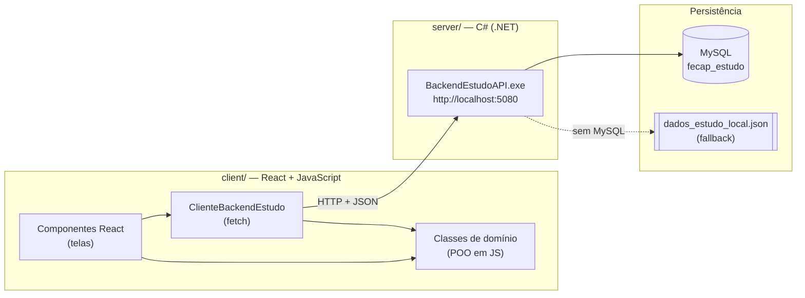
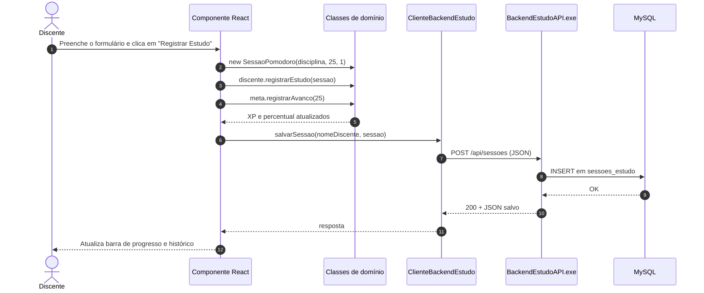
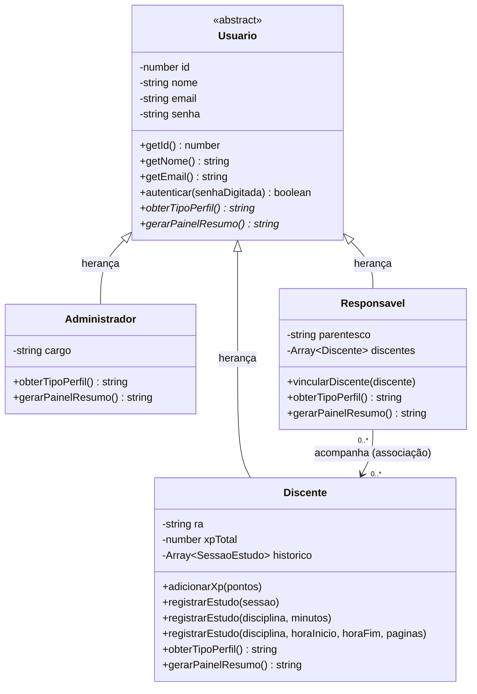
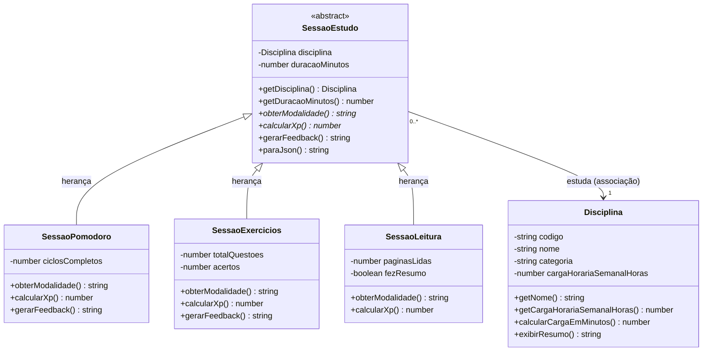
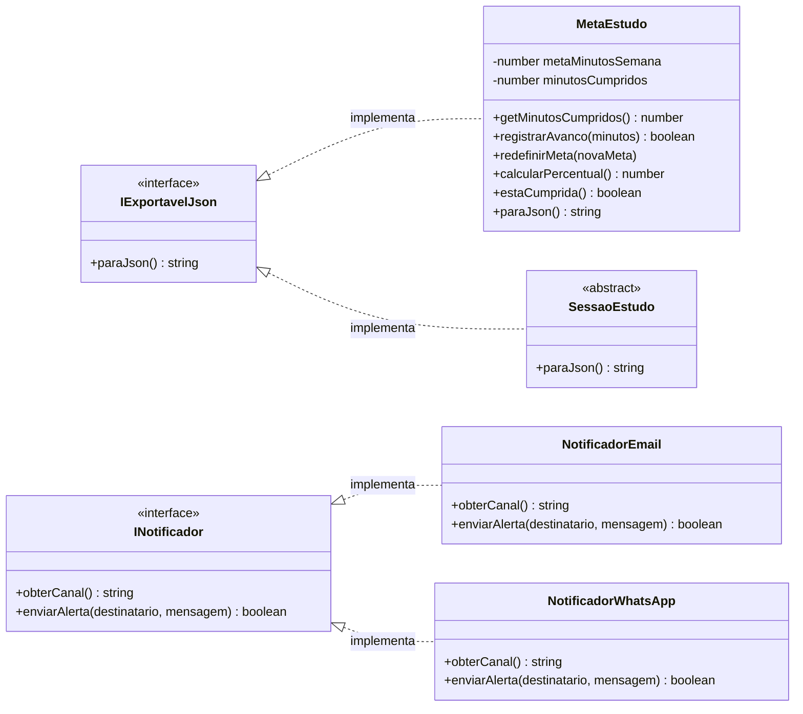
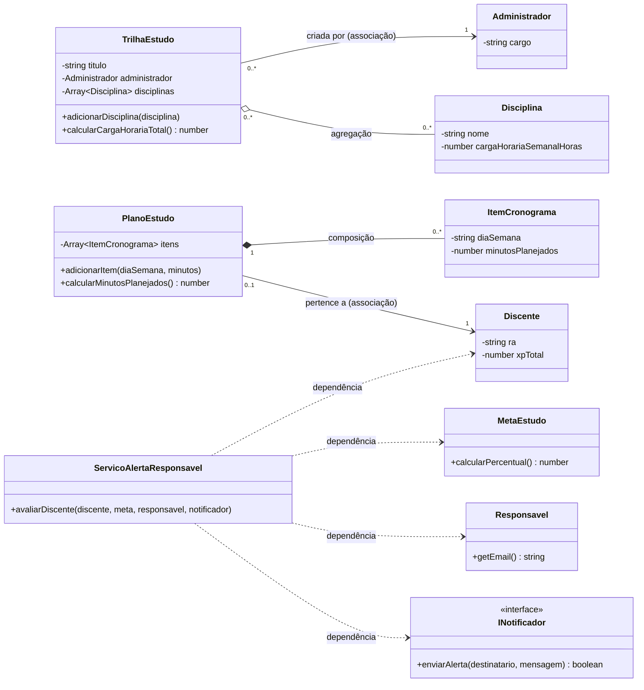

# FecapStudy — Plataforma de Apoio ao Estudo

> Mini-Projeto da **Aula 9 — Oficina Prática PBL** da disciplina de Programação Orientada a Objetos (FECAP).
> **client/** em **React + JavaScript** · **server/** em **C# (.NET)** · banco **MySQL**.

---

## 📌 Sumário

1. [Sobre o projeto](#-sobre-o-projeto)
2. [O problema (cenário PBL)](#-o-problema-cenário-pbl)
3. [Tecnologias](#-tecnologias)
4. [Estrutura do repositório](#-estrutura-do-repositório)
5. [Arquitetura](#-arquitetura)
6. [Diagramas de classes](#-diagramas-de-classes)
7. [Conceitos de POO aplicados](#-conceitos-de-poo-aplicados)
8. [Regras de negócio](#-regras-de-negócio)
9. [Como executar](#-como-executar)
10. [API do server](#-api-do-server)
11. [Roteiro de desenvolvimento (Missões 1 a 10)](#-roteiro-de-desenvolvimento-missões-1-a-10)
12. [Checklist de entrega](#-checklist-de-entrega)
13. [Equipe](#-equipe)

---

## 📖 Sobre o projeto

O **FecapStudy** ajuda **discentes** a organizar e medir seus estudos, permite que **responsáveis** acompanhem o cumprimento de metas semanais e dá aos **administradores** (coordenação/mentoria) ferramentas para montar trilhas de disciplinas e auditar o engajamento.

O sistema registra sessões de estudo em três modalidades (**Pomodoro**, **Lista de Exercícios** e **Leitura**), calcula pontos de experiência (**XP**), acompanha o progresso de uma **meta semanal em minutos** e envia **alertas** aos responsáveis. Os dados são salvos em um **MySQL local** por meio de uma API REST em C#.

---

## 🧩 O problema (cenário PBL)

| Perfil | Dor |
|---|---|
| **Discente** | Estuda sem métricas claras de foco e deixa matérias acumularem. |
| **Responsável** | Quer apoiar e acompanhar metas semanais sem precisar cobrar o tempo todo. |
| **Administrador** | Precisa estruturar trilhas de disciplinas e auditar o engajamento geral. |

---

## 🛠 Tecnologias

| Parte | Tecnologia |
|---|---|
| **client/** — interface | React + Vite |
| **client/** — classes de domínio (POO) | JavaScript (ES2022: classes, campos `#privados`, `extends`) |
| **client/** — comunicação | `fetch` (HTTP + JSON) |
| **server/** — API | `BackendEstudoAPI.exe` em C# (.NET), porta **5080** |
| Banco de dados | MySQL local (`fecap_estudo`), com fallback automático em JSON |

---

## 📁 Estrutura do repositório

```
fecapstudy/
├── client/                              # Frontend — React + JavaScript
│   ├── public/
│   ├── src/
│   │   ├── dominio/                     # Classes POO (sem nada de React)
│   │   │   ├── Disciplina.js
│   │   │   ├── MetaEstudo.js
│   │   │   ├── TrilhaEstudo.js
│   │   │   ├── PlanoEstudo.js
│   │   │   ├── ItemCronograma.js
│   │   │   ├── usuarios/
│   │   │   │   ├── Usuario.js           # abstrata
│   │   │   │   ├── Administrador.js
│   │   │   │   ├── Responsavel.js
│   │   │   │   └── Discente.js
│   │   │   └── sessoes/
│   │   │       ├── SessaoEstudo.js      # abstrata
│   │   │       ├── SessaoPomodoro.js
│   │   │       ├── SessaoExercicios.js
│   │   │       └── SessaoLeitura.js
│   │   ├── contratos/                   # "Interfaces" em JS
│   │   │   ├── contrato.js              # implementa() / garantirImplementacao()
│   │   │   ├── INotificador.js
│   │   │   └── IExportavelJson.js
│   │   ├── servicos/
│   │   │   ├── NotificadorEmail.js
│   │   │   ├── NotificadorWhatsApp.js
│   │   │   ├── ServicoAlertaResponsavel.js
│   │   │   └── ClienteBackendEstudo.js  # fetch → server
│   │   ├── componentes/                 # Telas React
│   │   │   ├── PainelPerfil.jsx
│   │   │   ├── FormularioSessao.jsx
│   │   │   ├── BarraProgresso.jsx
│   │   │   ├── HistoricoSessoes.jsx
│   │   │   ├── PainelResponsavel.jsx
│   │   │   ├── PainelTrilha.jsx
│   │   │   ├── PainelServidor.jsx
│   │   │   ├── StatusServidor.jsx
│   │   │   └── Aviso.jsx
│   │   ├── dados/
│   │   │   └── cenario.js               # objetos de exemplo usados pela tela
│   │   ├── demo/                        # "programa principal" de cada missão
│   │   │   ├── missao1.js … missao8.js
│   │   ├── App.jsx
│   │   ├── App.css
│   │   ├── main.jsx
│   │   └── index.css
│   ├── index.html
│   ├── package.json
│   └── vite.config.js
│
├── server/                              # Backend — C# (fornecido pelo professor)
│   ├── Source/                          # código-fonte (Program.cs + .csproj)
│   ├── BackendEstudoAPI.exe             # + .dll e .json do executável
│   ├── iniciar_backend.bat
│   ├── banco_estudo.sql
│   ├── mysql_config.example.txt         # copie para mysql_config.txt
│   └── .gitignore
│
├── docs/
│   └── diagramas/                       # Fontes editáveis dos diagramas
│       ├── 01-arquitetura.mmd
│       ├── 02-usuarios.mmd
│       ├── 03-sessoes-de-estudo.mmd
│       ├── 04-metas-e-interfaces.mmd
│       ├── 05-relacionamentos.mmd
│       └── 06-integracao-backend.mmd
│
├── .gitignore
└── README.md
```

> **Regra de ouro:** as classes de `client/src/dominio/` não importam nada de React. Os componentes **usam** os objetos; a lógica (XP, validações, percentual) fica nas classes.

---

## 🏗 Arquitetura



### Fluxo de "Registrar Estudo"



---

## 🧱 Diagramas de classes

O modelo foi dividido em quatro partes para ficar legível. Cada diagrama tem um arquivo-fonte em [`docs/diagramas/`](docs/diagramas/).

**Legenda UML:**

| Símbolo | Significado |
|---|---|
| `<\|--` linha contínua com ponta vazada | Herança ("é um") |
| `<\|..` linha tracejada com ponta vazada | Implementa interface |
| `-->` seta simples | Associação ("conhece") |
| `o--` losango vazio | Agregação (parte existe sem o todo) |
| `*--` losango cheio | Composição (parte nasce e morre com o todo) |
| `..>` tracejada | Dependência ("usa" por parâmetro) |
| `-` / `+` | privado / público |
| `*` depois do método | método abstrato |

### 1. Usuários (classe abstrata e herança)



### 2. Sessões de estudo (polimorfismo)



### 3. Meta e interfaces



### 4. Relacionamentos (associação, agregação, composição e dependência)



### ✏️ Como editar ou refazer os diagramas manualmente

Os diagramas são escritos em **Mermaid** (texto). O GitHub desenha automaticamente qualquer bloco ` ```mermaid ` no README.

- **Editar online:** cole o conteúdo de um arquivo `.mmd` em <https://mermaid.live>, ajuste e veja o resultado na hora. Depois, copie o texto de volta para o `.mmd` **e** para o bloco correspondente neste README.
- **No VS Code:** instale a extensão *Markdown Preview Mermaid Support* (ou *Mermaid Preview*) e use a pré-visualização do Markdown (`Ctrl+Shift+V`).
- **Desenhar à mão** (draw.io, Lucidchart, Astah, papel): exporte como PNG/SVG para `docs/diagramas/` e troque o bloco Mermaid por uma imagem:
  ```md
  
  ```

---

## 🎓 Conceitos de POO aplicados

| Conceito | Onde aparece | Missão |
|---|---|---|
| Abstração, Classe e Objeto | `Disciplina` | 1 |
| Encapsulamento | `MetaEstudo` (validações) e `Usuario` (senha sem getter) | 2 |
| Classe Abstrata e Herança | `Usuario` → `Administrador`, `Responsavel`, `Discente` | 3 |
| Polimorfismo Dinâmico | `calcularXp()` / `gerarFeedback()` nas 3 sessões | 4 |
| Polimorfismo Estático (sobrecarga) | `Discente.registrarEstudo(...)` com 3 formas de chamada | 5 |
| Interfaces | `INotificador`, `IExportavelJson` | 6 |
| Associação | `Responsavel → Discente`, `SessaoEstudo → Disciplina` | 7 |
| Agregação | `TrilhaEstudo ◇── Disciplina` | 7 |
| Composição | `PlanoEstudo ◆── ItemCronograma` | 8 |
| Dependência | `ServicoAlertaResponsavel ..> INotificador` | 8 |
| GUI + Backend | Componentes React + `ClienteBackendEstudo` → server C# | 9 e 10 |

### Como os conceitos ficam em JavaScript

JS não tem `abstract`, `interface` nem sobrecarga nativos. Convenções usadas no projeto:

```js
// Classe abstrata: bloqueia new direto e cobra os métodos abstratos
export class Usuario {
  #senha;
  constructor(id, nome, email, senha) {
    if (new.target === Usuario) throw new Error("Usuario é abstrata.");
    this.#senha = senha;
    // ...
  }
  obterTipoPerfil() { throw new Error("Método abstrato: implemente na subclasse."); }
}

// Interface: contrato documentado + verificação ("duck typing")
export function implementaNotificador(obj) {
  return typeof obj.obterCanal === "function" && typeof obj.enviarAlerta === "function";
}

// Sobrecarga: um único método que decide pelos argumentos
registrarEstudo(a, b, c, d) {
  if (a instanceof SessaoEstudo) { /* forma 1 */ }
  else if (a instanceof Disciplina && c === undefined) { /* forma 2 */ }
  else { /* forma 3 */ }
}
```

### Objetos + React

Quando um método muda o objeto por dentro (ex.: `meta.registrarAvanco(25)`), o React **não percebe** sozinho. Depois de alterar os objetos, atualize um estado para redesenhar a tela:

```jsx
const [, setVersao] = useState(0);

function registrar(sessao) {
  discente.registrarEstudo(sessao);
  meta.registrarAvanco(sessao.getDuracaoMinutos());
  setVersao(v => v + 1); // força o redesenho
}
```

---

## 📏 Regras de negócio

- **Disciplina:** carga horária ≤ 0 vira **2 h**; `calcularCargaEmMinutos() = horas × 60`.
- **MetaEstudo:**
  - meta ajustada ao intervalo **30 a 3000 minutos** (`redefinirMeta`, chamado também no construtor);
  - `registrarAvanco` recusa valores **≤ 0** ou **> 480** e devolve `false`;
  - não existe setter livre para `minutosCumpridos`;
  - `calcularPercentual()` vai de 0 a **100** (travado no máximo).
- **Usuário:** a senha nunca tem getter; só `autenticar(senhaDigitada)`.
- **XP por modalidade:**

| Modalidade | Fórmula |
|---|---|
| Pomodoro | `duracao × 2 + ciclos × 15` |
| Exercícios | `duracao + acertos × 10` |
| Leitura | `duracao + paginas × 3 + (fezResumo ? 25 : 0)` |

- **`registrarEstudo` (3 formas):**
  1. `(sessao)` → adiciona ao histórico e soma o XP;
  2. `(disciplina, minutos)` → cria `SessaoPomodoro` com `ciclos = Math.floor(minutos / 25)` (mínimo 1);
  3. `(disciplina, horaInicio, horaFim, paginas)` → minutos = `(horaFim − horaInicio) × 60`, cria `SessaoLeitura` com resumo.

---

## ▶ Como executar

### 1. server (C#)

1. Em `server/`, copie `mysql_config.example.txt` para **`mysql_config.txt`** (e coloque sua senha do MySQL, se tiver).
2. Dê duplo-clique em **`iniciar_backend.bat`** (ou `BackendEstudoAPI.exe`). É preciso ter o **runtime do .NET 10** instalado.
3. Abra **http://localhost:5080** para ver o painel de diagnóstico.

**MySQL (opcional):** o server lê `server/mysql_config.txt`:

```
Server=localhost;Port=3306;Database=fecap_estudo;Uid=root;Pwd=;
```

- Com MySQL rodando, o banco `fecap_estudo` e as tabelas `disciplinas`, `usuarios`, `metas_estudo` e `sessoes_estudo` são criados automaticamente.
- Com senha no MySQL, edite `Pwd=sua_senha;` ou configure em `http://localhost:5080`.
- Sem MySQL, o server usa `dados_estudo_local.json` com **as mesmas rotas**.

### 2. client (React)

Requisito: **Node.js 20.19+** (ou 22.13+).

```bash
cd client
npm install
npm run dev
```

Acesse **http://localhost:5173**.

### 3. Testar as missões no terminal

Cada missão de domínio (1 a 8) tem um "programa principal" que roda direto no Node, sem abrir a tela:

```bash
cd client
node src/demo/missao1.js   # troque o número: missao1.js … missao8.js
```

### 4. Testar a integração

1. Com o server rodando, abra o client e registre uma sessão.
2. A janela preta do backend mostra uma linha como `POST /api/sessoes -> Lucas Silva estudou ...`.
3. Clique em **Carregar Histórico do Servidor / Relatório** para ver os dados gravados no banco.
4. Clique uma vez em **Redefinir meta** para gravar a meta do Lucas no servidor (sem isso o relatório usa a meta padrão de 180 min).

Por padrão o client acessa o server em `http://localhost:5080`. Para usar outra URL, crie `client/.env` com `VITE_API_URL=http://outro-endereco:porta`. O CORS do server já está liberado para qualquer origem.

### 5. .gitignore sugerido

```gitignore
# client
client/node_modules/
client/dist/
client/.env

# server
server/dados_estudo_local.json
```

> Se o seu `mysql_config.txt` tiver senha real, não suba esse arquivo: crie um `mysql_config.example.txt` e adicione `server/mysql_config.txt` ao `.gitignore`.

---

## 🌐 API do server

Base URL: `http://localhost:5080`

| Método | Rota | Descrição |
|---|---|---|
| `GET` | `/api/status` | Status da conexão com o MySQL e totais |
| `GET` | `/api/disciplinas` | Lista disciplinas |
| `POST` | `/api/disciplinas` | Cadastra disciplina |
| `GET` | `/api/usuarios` | Lista usuários |
| `POST` | `/api/usuarios` | Cadastra usuário |
| `GET` | `/api/sessoes` | Lista sessões de estudo |
| `POST` | `/api/sessoes` | Grava sessão e soma minutos na meta |
| `GET` | `/api/metas` | Lista metas semanais |
| `POST` | `/api/metas` | Cria/atualiza meta semanal |
| `GET` | `/api/relatorio/{nome}` | Boletim consolidado do discente |

### Exemplos de corpo (POST)

```jsonc
// POST /api/disciplinas
{ "nome": "POO", "categoria": "Computação", "cargaHorariaSemanal": 4 }

// POST /api/usuarios
{ "nome": "Lucas", "email": "lucas@fecap.br", "tipoPerfil": "Discente", "matriculaOuCargo": "RA-101" }

// POST /api/sessoes
{
  "discenteNome": "Lucas Silva",
  "disciplina": "POO",
  "tipoModalidade": "Pomodoro",
  "duracaoMinutos": 25,
  "xpGanho": 65,
  "resumoFeedback": "1 ciclo"
}

// POST /api/metas
{ "discenteNome": "Lucas Silva", "responsavelNome": "Carlos", "metaMinutosSemana": 200 }
```

### `ClienteBackendEstudo` (client/src/servicos)

```js
export class ClienteBackendEstudo {
  #urlBase;

  constructor(urlBase = import.meta.env.VITE_API_URL) {
    this.#urlBase = urlBase;
  }

  async listarSessoes() {
    const resposta = await fetch(`${this.#urlBase}/api/sessoes`);
    return resposta.json();
  }

  async salvarSessao(nomeDiscente, sessao) {
    const resposta = await fetch(`${this.#urlBase}/api/sessoes`, {
      method: "POST",
      headers: { "Content-Type": "application/json" },
      body: JSON.stringify({
        discenteNome: nomeDiscente,
        disciplina: sessao.getDisciplina().getNome(),
        tipoModalidade: sessao.obterModalidade(),
        duracaoMinutos: sessao.getDuracaoMinutos(),
        xpGanho: sessao.calcularXp(),
        resumoFeedback: sessao.gerarFeedback()
      })
    });
    return resposta.json();
  }

  async obterRelatorio(nomeDiscente) {
    const resposta = await fetch(`${this.#urlBase}/api/relatorio/${encodeURIComponent(nomeDiscente)}`);
    return resposta.json();
  }
}
```

---

## 🗺 Roteiro de desenvolvimento (Missões 1 a 10)

- [x] **Missão 1 — Abstração, Classes e Objetos:** `Disciplina` + 3 instâncias reais do semestre.
- [x] **Missão 2 — Encapsulamento:** `MetaEstudo` com campos `#privados`, `registrarAvanco` e `redefinirMeta` validados.
- [x] **Missão 3 — Classe Abstrata e Herança:** `Usuario` abstrata → `Administrador`, `Responsavel`, `Discente`.
- [x] **Missão 4 — Polimorfismo Dinâmico:** as 3 sessões em um array percorrido sem `if` por tipo.
- [x] **Missão 5 — Polimorfismo Estático:** `registrarEstudo` com 3 formas de chamada em `Discente`.
- [x] **Missão 6 — Interfaces:** `INotificador` (Email, WhatsApp) e `IExportavelJson`.
- [x] **Missão 7 — Associação e Agregação:** `Responsavel.vincularDiscente` e `TrilhaEstudo.adicionarDisciplina`.
- [x] **Missão 8 — Composição e Dependência:** `PlanoEstudo` cria `ItemCronograma`; `ServicoAlertaResponsavel.avaliarDiscente`.
- [x] **Missão 9 — Interface React:** painel de perfil, formulário de sessão, barra de progresso, histórico e botão "Notificar Responsável".
- [x] **Missão 10 — Integração:** `ClienteBackendEstudo` com `POST /api/sessoes` e botão para carregar histórico/relatório do server.

---

## ✅ Checklist de entrega

- [x] `Disciplina` modelada e instanciada.
- [x] `MetaEstudo` e `Usuario` com campos privados e validações.
- [x] `Usuario` abstrata herdada pelos 3 perfis (bloqueio com `new.target`).
- [x] 3 modalidades de `SessaoEstudo` sobrescrevendo XP e feedback.
- [x] `registrarEstudo` com 3 formas de chamada.
- [x] `INotificador` e `IExportavelJson` implementadas e usadas.
- [x] Associação, agregação, composição e dependência presentes no código.
- [x] Classes de domínio separadas dos componentes React.
- [x] Tela enviando `POST /api/sessoes` para o server.
- [x] Teste de integração: a sessão aparece no terminal do server e em `/api/sessoes` ou `/api/relatorio/{nome}`.

---

## 👥 Equipe

| Nome | RA | Responsabilidade |
|---|---|---|
| Matheus Gajewski de Melo | 26029468 | Desenvolvimento |

- **Disciplina:** Programação Orientada a Objetos — FECAP
- **Professor:** Adriano Valente
- **Semestre:** 2026/2
